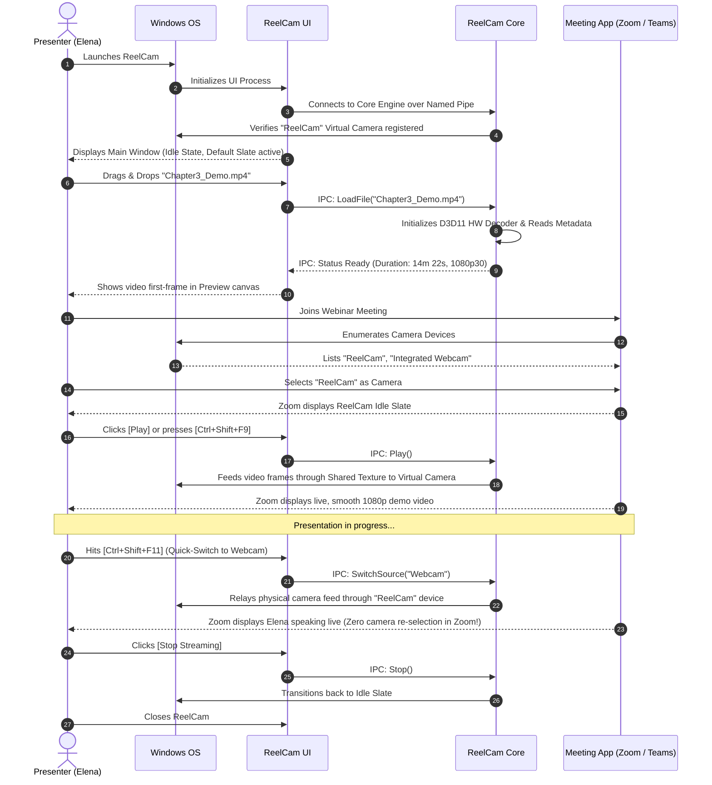

# ReelCam User Journeys & Screen Flows (Appflow)

## 1. Primary User Journey



---

## 2. First-Run & Onboarding Flow

1. **Installer Launch**: User runs `ReelCamSetup.msix`. Windows App Installer verifies Authenticode signature and finishes in < 15 seconds.
2. **First App Launch**:
   - Application checks if the virtual camera device is registered. If unregistered, it calls `MFCreateVirtualCamera` and prompts for user camera permissions if blocked by Windows Privacy settings.
   - Shows a clean, 3-card onboarding banner above the preview area:
     1. *"Step 1: Pick or drop your presentation video file."*
     2. *"Step 2: Choose 'ReelCam' as your camera in Zoom, Teams, or Google Meet."*
     3. *"Step 3: Press Play or use global hotkey Ctrl+Shift+F9 to stream."*
   - A checkbox `"Don't show this guide again"` dismisses the banner permanently.
3. **Default State**:
   - Video canvas displays a modern, branded ReelCam 1080p idle card with subtle text: *"ReelCam Ready — Load a video to stream"*.
   - Stream status indicator shows a soothing blue badge: `Ready (Idle)`.

---

## 3. Screen-by-Screen Map

### 3.1 Main Window (`MainWindow.xaml`)

```
+------------------------------------------------------------------------------------+
| [o] ReelCam                                               [Live]  [Settings] [_][X] |
+------------------------------------------------------------------------------------+
|                                                                                    |
|                                                                                    |
|                           VIDEO PREVIEW VIEWPORT                                   |
|                             (SwapChainPanel)                                       |
|                                                                                    |
|                          [● Pre-recorded Badge]                                    |
|                                                                                    |
+------------------------------------------------------------------------------------+
|  [> Play] [|| Pause] [[] Stop]   00:04:12 / 00:14:22   [Loop: On]  [Webcam Switch] |
|  ========o-------------------------------------------------------- (Timeline Scrub)|
+------------------------------------------------------------------------------------+
| Source: C:\Presentations\Product_Demo_Q4.mp4 [Browse...]                           |
| Output: [1080p v] [30 fps v]  |  Scale: [Fit (Letterbox) v]  |  [x] Mirror Video   |
+------------------------------------------------------------------------------------+
```

#### Detailed Element Specifications
1. **Title Bar**:
   - Application icon and name `"ReelCam"`.
   - **Live Status Pill**:
     - `Streaming` (Vibrant Emerald Green with pulsing indicator).
     - `Paused` (Amber Yellow).
     - `Idle` (Slate Gray).
     - `Error` (Crimson Red with click-for-details tooltip).
   - Quick navigation buttons: `Recent Files`, `Settings Gear`, `Minimize to Tray`, `Close`.
2. **Preview Viewport (`SwapChainPanel`)**:
   - Zero-latency 16:9 responsive presentation view.
   - Live rendering includes user-configured post-processing: mirror flips, scaling boundaries, and the `"● Pre-recorded"` transparency badge.
3. **Playback Control Bar**:
   - **Primary Action Button**: High-contrast icon button toggling between `Play` and `Pause`.
   - **Stop Button**: Halts playback, resets scrub head to `00:00:00`, and switches virtual camera output to the Idle Source.
   - **Timestamp Display**: Monospaced font display of `hh:mm:ss` (Current) / `hh:mm:ss` (Total).
   - **Loop Toggle**: Toggles single-clip repeat mode.
   - **Physical Webcam Passthrough Button**: One-click toggle switching between file stream and live hardware webcam input.
4. **Timeline Scrubber**:
   - Interactive scrub bar with hover timestamp thumbnail previews.
   - Dragging the thumb scrubs playback in real-time on both preview and virtual camera.
5. **Output & Source Bar**:
   - File path display with ellipsis trimming and `[Browse...]` button.
   - Format drop-downs: Resolution (`720p`, `1080p`), Frame Rate (`30 fps`, `60 fps`).
   - Scaling Mode selector (`Fit`, `Crop`, `Stretch`).
   - `Mirror Video` checkbox for selfie orientation.

---

### 3.2 Settings Dialog (`SettingsDialog.xaml`)

Divided into five structured tabs:

1. **Camera Device Status**:
   - Device Name: `"ReelCam"`.
   - Driver Type: Windows 11 Media Foundation Virtual Camera (User-mode).
   - Status: Active / Registered.
   - Diagnostic action: `[Re-register Virtual Camera]` button for troubleshooting.
2. **Pre-recorded Badge**:
   - `Enable Badge`: Toggle switch (Default: `ON`).
   - `Badge Position`: Radio buttons: Top-Left, Top-Right, Bottom-Left, Bottom-Right (Default: Bottom-Right).
   - `Opacity`: Slider from 30% to 100% (Default: 75%).
   - Preview swatch showing exact appearance.
3. **Idle Source Configuration**:
   - Option A: Default ReelCam Slate (clean branded aesthetic).
   - Option B: Custom Still Image (PNG/JPEG selector with file preview).
   - Option C: Solid Black Frame.
   - Option D: Hardware Webcam Passthrough.
4. **Global Hotkeys**:
   - Key-combination capture boxes:
     - *Toggle Play/Pause*: Default `Ctrl + Shift + F9`.
     - *Stop & Show Idle*: Default `Ctrl + Shift + F10`.
     - *Toggle Webcam Passthrough*: Default `Ctrl + Shift + F11`.
   - Conflict detection indicator (warns if another app holds the shortcut).
5. **Application & Behavior**:
   - `Close Button Action`: Minimize to Notification Tray vs. Terminate App.
   - `Launch at Windows Startup`: Toggle switch.
   - `Hardware Acceleration`: Toggle D3D11 Video Acceleration (Default: `ON`).

---

### 3.3 System Tray & Notification Area

- **Tray Icon Appearance**:
  - `Green Reel`: Active streaming in progress.
  - `Amber Reel`: Playback paused.
  - `Gray Reel`: App running, camera idle.
  - `Red Reel`: Video decoding or camera registration error.
- **Context Menu (Right-Click)**:
  - **Open ReelCam**: Restores and focuses main window.
  - *Separator*
  - **Play / Pause**: Context-aware toggle.
  - **Switch to Webcam**: Quick toggle.
  - **Stop**: Switches to idle source.
  - *Separator*
  - **Current File**: Shows active clip name with checkmark.
  - **Settings...**: Opens settings dialog.
  - *Separator*
  - **Exit ReelCam**: Shuts down core engine and cleanly unhooks virtual camera.

---

## 4. Comprehensive State Handling & Edge Cases

### 4.1 Empty States
1. **First Launch (No File Loaded)**:
   - Preview canvas displays the designated Idle Slate.
   - Play button is disabled; Browse / Drag-and-Drop area is highlighted with subtle pulsing dashed border.
   - Status bar shows: *"No video file selected. Drop an MP4, MOV, MKV, or WebM file here to begin."*
2. **No Physical Webcam Available**:
   - In Settings and Main Window, the `Webcam Switch` button is disabled with tooltip: *"No physical camera detected on this system."*

### 4.2 Loading & Transition States
1. **File Opening / Parsing**:
   - When a 10 GB video file is dropped, the UI displays a spinner overlay: *"Opening video and initializing hardware decoder..."*.
   - Play controls remain disabled until `IMFSourceReader` reports first stream format and duration (< 200ms).
2. **Switching between File and Webcam**:
   - Zero-blackout crossfade: Core engine keeps outputting the last video frame until the first hardware camera sample arrives from `IMFMediaSource`, avoiding black flashes in Zoom.

### 4.3 Error States & Diagnostic Guidance

| Error Scenario | Root Cause | System Response | User-Facing Actionable Notification |
| :--- | :--- | :--- | :--- |
| **Unsupported Codec** | Video encoded in H.265 (HEVC) or Apple ProRes | Source Reader initialization fails with `MF_E_UNSUPPORTED_BYTESTREAM_TYPE` | *"This video uses a codec that is not supported in ReelCam v1 (e.g. H.265/ProRes). Please use an H.264, VP9, or AV1 video."* |
| **File Moved / Deleted** | User deleted file from disk while loaded in app | File read call fails with `ERROR_FILE_NOT_FOUND` | *"The file '[Filename]' could not be found at its original path. It may have been moved or deleted."* (Auto-resets to Idle) |
| **Corrupt / Truncated Video** | Incomplete download or recording crash | Decoder encounters unexpected EOF mid-stream | *"Playback stopped: the video stream contains corrupted data. Playback will reset to the beginning."* |
| **Windows Camera Privacy Disabled** | Windows 11 Privacy toggle blocks camera access | `MFCreateVirtualCamera` or consuming app blocked | Infobar Banner: *"Windows Camera Privacy is currently blocking camera access. Open Windows Settings > Privacy > Camera and enable 'Let apps access your camera'."* [Open Settings Button] |
| **ReelCam Core Crash** | Core process terminated via Task Manager | `mfsource.dll` heartbeat timer expires | Consuming app in Zoom automatically sees the embedded Idle Slate. UI displays: *"Core engine stopped unexpectedly. [Restart Core Engine]"* |

### 4.4 Edge Cases
1. **App Closed While Meeting is Active**:
   - If the user closes `reelcam_ui.exe` while Zoom is actively streaming `"ReelCam"`, the app prompts:
     `"ReelCam is currently streaming to a meeting application. Do you want to minimize to the system tray instead?"`
     Buttons: `[Minimize to Tray (Recommended)]` | `[Stop and Exit]`.
2. **Network Drive Disconnection**:
   - If playing from `Z:\Share\video.mp4` and network disconnects, the playback engine pauses immediately, displays a reconnect banner, and holds the last decoded frame on the camera feed for up to 30 seconds before falling back to Idle Slate.
3. **Very Short Clips (< 1 Second)**:
   - Clamped to loop smoothly without decoder thrashing.
4. **Display DPI & Multi-Monitor Changes**:
   - Fully DPI-aware (Per-Monitor v2). Moving the window between a 4K 175% laptop display and a 1080p 100% monitor scales WinUI controls and SwapChain viewport seamlessly without blur.
