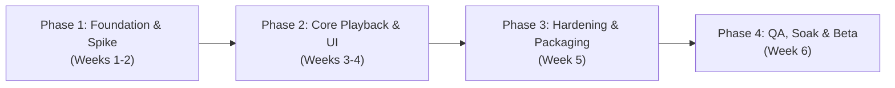

# ReelCam Implementation & Engineering Roadmap (ImplementationPlan)

## 1. Engineering Principles & Milestone Structure

This implementation plan breaks ReelCam development into four verifiable phases over six weeks. Each task defines concrete verification commands, observable outputs, and dependency gates.



---

## 2. Phase 1: Foundation & Virtual Camera Spike (Weeks 1–2)

### Milestone Goal
Prove that Windows 11 `MFCreateVirtualCamera` can be created, registered, and successfully stream generated test patterns and decoded local MP4 frames into Google Chrome and the Windows Camera app.

---

### Task 1.1: Project Scaffolding & Build Pipeline
- **Owner**: Core Engineering
- **Actions**:
  1. Create repository folder structure (`src/core`, `src/mfsource`, `src/ipc`, `src/ui`, `src/common`, `tests`, `tools`).
  2. Author root `CMakeLists.txt` configured for C++20 with strict warnings (`/W4 /WX` on MSVC).
  3. Configure `vcpkg.json` manifest mode for native dependencies (`wil`, `gtest`).
  4. Scaffold Visual Studio solution with WinUI 3 C# project (`ReelCam.UI.csproj`) targeting `.NET 8` and `Windows App SDK 1.5+`.
  5. Setup GitHub Actions workflow `.github/workflows/build.yml` running on `windows-2022`.
- **Verification Commands**:
  ```powershell
  # Configure and build native C++ components
  cmake -B build -S . -DCMAKE_TOOLCHAIN_FILE="C:/vcpkg/scripts/buildsystems/vcpkg.cmake"
  cmake --build build --config RelWithDebInfo

  # Build C# WinUI 3 project
  dotnet build src/ui/ReelCam.UI.csproj -c RelWithDebInfo
  ```
- **Acceptance Gate**: Native DLLs and executables build with zero compiler warnings; CI pipeline passes cleanly.

---

### Task 1.2: Media Foundation Virtual Camera Spike (`mfsource.dll`)
- **Owner**: Media Systems Engineer
- **Actions**:
  1. Implement COM class factory and registration for `CLSID_ReelCamMediaSource` (`{E7B1A280-9A23-4560-BD92-358F58A009C1}`).
  2. Implement minimal `IMFMediaSource`, `IMFMediaStream`, and `IMFMediaTypeHandler`.
  3. Expose media type `MFVideoFormat_NV12` at 1920x1080 @ 30.0 fps.
  4. Author CLI registration tool `tools/register_cam.exe` invoking `MFCreateVirtualCamera` and user-hive COM registration.
  5. Implement procedural test generator inside `IMFMediaStream`: outputs SMPTE color bars with an alternating 1 Hz time blink block.
- **Verification Commands**:
  ```powershell
  # Register the virtual camera in user hive
  ./build/bin/tools/register_cam.exe --register

  # Launch Windows Camera app
  start microsoft.windows.camera:
  ```
- **Acceptance Gate**:
  1. Windows Settings > Bluetooth & Devices > Cameras lists `"ReelCam"`.
  2. Opening Windows Camera app and switching to `"ReelCam"` shows smooth 1080p30 color bars.
  3. Opening `https://webcamtests.com` in Google Chrome and Microsoft Edge detects `"ReelCam"` and renders the color bar pattern.

---

### Task 1.3: Hardware-Accelerated Local Video Decode
- **Owner**: Core Engineering
- **Actions**:
  1. Implement `ReelCam::Core::Decoder` wrapping `IMFSourceReader` with `MF_SOURCE_READER_D3D11_AWARE`.
  2. Author D3D11 device creation and DXGI manager sharing pipeline.
  3. Ingest sample H.264 MP4 file (`tests/media/1080p30.mp4`).
  4. Convert decoded NV12 samples to shared DXGI texture surfaces.
  5. Author initial QPC-based frame pacing loop using high-resolution waitable timers.
- **Verification Commands**:
  ```powershell
  # Run standalone pipeline test streaming test MP4 to registered virtual camera
  ./build/bin/reelcam_core_test.exe --input "tests/media/1080p30.mp4" --duration 30
  ```
- **Acceptance Gate**:
  1. Test MP4 streams continuously into Google Chrome via `"ReelCam"` without tearing or stuttering.
  2. Process CPU utilization remains < 10% on reference test laptop.

---

## 3. Phase 2: Core Playback Engine & UI (Weeks 3–4)

### Milestone Goal
Implement the complete decoupled process architecture, inter-process communication (IPC), full playback controls, video post-processing, WinUI 3 desktop interface, global hotkeys, and system tray integration.

---

### Task 2.1: Named Pipe IPC & State Machine Architecture
- **Owner**: Systems Engineer
- **Actions**:
  1. Implement `ReelCam::IPC::PipeServer` (C++) and `ReelCam.UI.Services.IpcClient` (C#).
  2. Implement bidirectional UTF-8 JSON message envelope with length-prefixed framing.
  3. Implement DACL security descriptor restricting pipe connection strictly to current user SID.
  4. Author core state machine (`Idle`, `Loading`, `Ready`, `Playing`, `Paused`, `Error`).
- **Verification Commands**:
  ```powershell
  # Run IPC unit & roundtrip integration tests
  ./build/bin/tests/ipc_unit_tests.exe
  ```
- **Acceptance Gate**: Roundtrip message latency < 5 ms; pipe reconnection succeeds automatically on process restart.

---

### Task 2.2: Comprehensive Playback Controls & Frame Pacing
- **Owner**: Core Engineering
- **Actions**:
  1. Implement `Play`, `Pause`, `Stop`, and `Seek` command handlers in Core engine.
  2. Implement precision timeline seeking: flushes decoder pipeline and seeks `IMFSourceReader` to target PTS.
  3. Implement loop modes: seamless single-clip loop and end-of-clip fallback actions.
  4. Guarantee monotonic timestamp delivery during looping so WebRTC consumers do not disconnect.
- **Verification Commands**:
  ```powershell
  ./build/bin/tests/pacing_unit_tests.exe
  ```
- **Acceptance Gate**: Seeking across a 60-minute video updates output within < 100 ms; looping maintains continuous 30 fps stream without dropped-frame spikes.

---

### Task 2.3: Video Post-Processing Pipeline
- **Owner**: Graphics Engineer
- **Actions**:
  1. Implement D3D11 Video Processor scaling:
     - `Fit` (Letterbox / Pillarbox with black bars)
     - `Crop` (Center crop maintaining aspect ratio)
     - `Stretch`
  2. Implement horizontal Mirror transformation toggle.
  3. Implement `"● Pre-recorded"` transparency badge overlay: D3D11 alpha-blends watermark into user-selected corner quadrant.
- **Verification Commands**:
  ```powershell
  ./build/bin/tests/video_processor_tests.exe
  ```
- **Acceptance Gate**: Watermark and mirror toggles take effect instantly in output frame without stalling playback.

---

### Task 2.4: Idle Source & Physical Webcam Passthrough
- **Owner**: Media Systems Engineer
- **Actions**:
  1. Bundle default branded 1080p idle slate PNG; convert to pre-rendered NV12 memory texture.
  2. Implement custom image loader (PNG/JPEG) for user-defined idle cards.
  3. Implement physical webcam capture relay using Media Foundation Capture Engine.
  4. Implement cross-stream switcher: seamless swap between video and webcam without frame server glitch.
- **Verification Commands**:
  ```powershell
  # Test source switching speed
  ./build/bin/tests/source_switcher_tests.exe
  ```
- **Acceptance Gate**: Switching from demo video to physical webcam completes in < 250 ms with zero black flashes or consumer disconnects.

---

### Task 2.5: WinUI 3 Desktop Interface
- **Owner**: Frontend Engineer
- **Actions**:
  1. Author `MainWindow.xaml` featuring Fluent Design and Mica backdrop.
  2. Implement low-latency video preview viewport via `SwapChainPanel`.
  3. Author playback controls (large Play/Pause button, Seek slider with timestamp, Loop toggle).
  4. Implement drag-and-drop file ingestion and `[Browse...]` file picker.
  5. Author `SettingsDialog.xaml` with tabbed configuration for badge, hotkeys, idle source, and devices.
- **Verification Commands**:
  ```powershell
  dotnet test tests/ui/ReelCam.UI.Tests.csproj
  ```
- **Acceptance Gate**: UI runs smoothly at 60 fps; controls feel immediate and responsive; settings persist cleanly in `settings.json`.

---

### Task 2.6: System Tray & Global Hotkeys
- **Owner**: Desktop Integration Engineer
- **Actions**:
  1. Implement Win32 `RegisterHotKey` interop for `Ctrl+Shift+F9` (Play/Pause), `Ctrl+Shift+F10` (Stop), `Ctrl+Shift+F11` (Webcam).
  2. Implement system tray icon reflecting state colors (Green = Streaming, Amber = Paused, Slate = Idle, Red = Error).
  3. Implement tray context menu with quick controls and "Minimize to Tray" behavior.
- **Verification Commands**:
  - Test hotkey triggers while third-party apps (Notepad, PowerPoint, Edge) have active keyboard focus.
- **Acceptance Gate**: Hotkeys respond reliably while typing in other full-screen applications.

---

## 4. Phase 3: Hardening & Packaging (Week 5)

### Milestone Goal
Implement fault tolerance, corrupt media recovery, playlist support, and an Authenticode-signed MSIX installation package with clean uninstallation.

---

### Task 3.1: Error Handling & Core Crash Recovery
- **Owner**: Reliability Engineer
- **Actions**:
  1. Stress-test decoder against malformed, truncated, and unsupported media files (`tests/media/corrupt.mp4`).
  2. Implement heartbeat monitoring in `mfsource.dll`: if `reelcam_core.exe` is killed via Task Manager, `mfsource.dll` seamlessly switches to emitting the static Idle Slate.
  3. Ensure consuming applications never crash or experience hanging COM threads.
- **Verification Commands**:
  ```powershell
  # Kill core process mid-stream while Chrome is consuming camera
  Stop-Process -Name "reelcam_core" -Force
  ```
- **Acceptance Gate**: Chrome camera stream immediately shows the Idle Slate; browser does not crash, freeze, or drop the WebRTC track.

---

### Task 3.2: Multi-Clip Playlist
- **Owner**: Software Engineer
- **Actions**:
  1. Implement playlist data model in UI and Core engine.
  2. Support adding multiple clips, drag-to-reorder, and clip duration summaries.
  3. Implement gapless transition between consecutive playlist items.
- **Verification Commands**:
  - Queue 3 different video clips with varied resolutions (720p, 1080p, 4K); observe sequential playback.
- **Acceptance Gate**: Transition between clips occurs without dropped frames or resolution distortion.

---

### Task 3.3: Signed MSIX Package & Clean Uninstall
- **Owner**: DevOps & Packaging Engineer
- **Actions**:
  1. Author Windows App Package manifest (`Package.appxmanifest`) declaring Virtual Camera COM extensions.
  2. Configure Microsoft Authenticode signing pipeline in GitHub Actions.
  3. Verify installation on clean Windows 11 virtual machine.
  4. Verify uninstallation: ensure virtual camera device and registry keys are cleanly removed.
- **Verification Commands**:
  ```powershell
  # Install MSIX
  Add-AppxPackage -Path ./dist/ReelCam_1.0.0_x64.msix

  # Verify camera registered
  Get-PnpDevice -FriendlyName "ReelCam"

  # Uninstall MSIX
  Remove-AppxPackage -Package "ReelCam_1.0.0.0_x64__xxxx"

  # Verify camera cleanly uninstalled
  (Get-PnpDevice -FriendlyName "ReelCam" -ErrorAction SilentlyContinue) -eq $null
  ```
- **Acceptance Gate**: Zero orphaned devices or COM CLSIDs remain after uninstall.

---

## 5. Phase 4: QA, Soak Testing & Beta Release (Week 6)

### Milestone Goal
Validate performance budgets, conduct 60-minute soak tests, verify compatibility across top 5 meeting and browser apps, and produce the final 1.0.0 Beta release.

---

### Task 4.1: Cross-Application Compatibility Matrix
- **Owner**: QA Engineering
- **Actions**:
  - Test `"ReelCam"` selection, streaming, pausing, and camera switching across:
    1. Google Chrome (v120+)
    2. Microsoft Edge (v120+)
    3. Zoom Desktop Client (v5.17+)
    4. Microsoft Teams (New Teams v24+)
    5. Discord Desktop Client
- **Acceptance Gate**: 100% pass rate (5/5 apps); recorded video evidence archived in `tests/verification/`.

---

### Task 4.2: 60-Minute Soak & Drift Test
- **Owner**: Performance Engineer
- **Actions**:
  1. Run continuous 60-minute 1080p30 video stream into local camera capture harness (`tools/cam_timing_probe.exe`).
  2. Continuously log memory working set, CPU utilization, GPU VRAM, and timestamp drift.
- **Verification Commands**:
  ```powershell
  ./build/bin/tools/soak_test_runner.exe --duration 3600 --resolution 1080p --fps 30
  ```
- **Acceptance Gate**:
  - Timestamp drift < 40 ms over 60 minutes.
  - Zero unhandled exceptions or crash events.
  - Working set memory growth < 10 MB between minute 5 and minute 60 (zero leaks).
  - Average CPU < 10% on reference Intel Core i5 test machine.

---

### Task 4.3: Beta Release Candidate Build
- **Owner**: Lead Engineer
- **Actions**:
  1. Tag release `v1.0.0-beta.1`.
  2. Generate release package `ReelCam_1.0.0_Beta1_x64.msix`.
  3. Publish user quickstart documentation and known issues list in `README.md`.
- **Acceptance Gate**: Signed installer ready for beta tester distribution.
