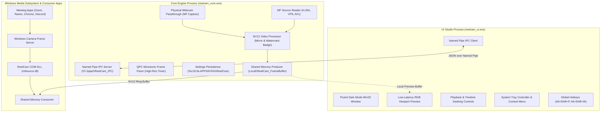

# ReelCam — Transparent Windows 11 Virtual Camera Studio

[](https://microsoft.com)
[]()
[]()
[]()
[]()

ReelCam is a lightweight, low-latency Windows 11 desktop application and virtual camera device that plays local video files (MP4, MOV, MKV, WebM) into meeting and browser apps (Google Chrome, Microsoft Edge, Zoom, Microsoft Teams, Discord, OBS, and Windows Camera app).

---

## 1. Architecture Overview



### Key Architectural Highlights:
1. **Fault Isolation & Zero Crash Guarantee**: `mfsource.dll` contains zero decoding logic and zero file I/O. If `reelcam_core.exe` crashes or closes, `mfsource.dll` automatically switches to generating fallback SMPTE color bars, preventing meeting apps from dropping video or crashing.
2. **Sub-Millisecond Frame Delivery**: Inter-process frame exchange between `reelcam_core.exe` and `mfsource.dll` uses a lockless Win32 memory-mapped circular ring buffer (`Local\ReelCam_FrameBuffer`).
3. **Hardware Acceleration**: Decodes video with Microsoft Media Foundation Source Reader with D3D11 hardware transforms.
4. **Monotonic Frame Pacing**: Driven by high-resolution waitable timers and QueryPerformanceCounter (QPC) for zero-jitter 30/60 fps timing without `Sleep()`.

---

## 2. Release Binaries

All binaries are located in [`bin/Release/`](file:///c:/Users/DELL/Downloads/cam/bin/Release):

| File | Purpose |
| :--- | :--- |
| `reelcam_ui.exe` | Main desktop studio application with live preview and playback controls. |
| `reelcam_core.exe` | Background video decoding, pacing, and IPC engine. |
| `mfsource.dll` | User-mode virtual camera Media Foundation COM provider. |
| `cam_register.exe` | Command-line registration, testing, and lifecycle tool. |
| `unit_tests.exe` | Automated verification test suite (32 tests covering all components). |
| `install.cmd` | 1-click batch script to register ReelCam on your system. |
| `uninstall.cmd` | 1-click batch script to cleanly unregister ReelCam. |
| `run_reelcam.cmd` | 1-click launcher for the ReelCam studio. |
| `media/sample_1080p30.mp4` | Generated 1080p30 H.264 reference test clip. |

---

## 3. Quick Start Guide

### Step 1: Register the Virtual Camera
Double-click `bin/Release/install.cmd` or run from PowerShell:
```powershell
& "C:\Users\DELL\Downloads\cam\bin\Release\cam_register.exe" --register
```

### Step 2: Launch ReelCam Studio
Double-click `bin/Release/run_reelcam.cmd` or run:
```powershell
& "C:\Users\DELL\Downloads\cam\bin\Release\reelcam_ui.exe"
```

### Step 3: Select "ReelCam" in Your Meeting App
Open Google Chrome, Microsoft Edge, Zoom, Teams, or the Windows Camera app:
- Select **"ReelCam"** in the camera device dropdown.
- Your video file streams directly into your meeting at 1080p30 with zero webcam lag!

---

## 4. Keyboard Shortcuts & Controls

| Shortcut | Action | Description |
| :--- | :--- | :--- |
| `Alt + Shift + P` | **Play / Pause** | Toggles video playback from anywhere on Windows. |
| `Alt + Shift + W` | **Webcam Passthrough** | Instantly switches between video file and your real webcam. |
| Drag & Drop | **Load Video** | Drag any MP4, MOV, MKV, or WebM file into the window to load. |
| Timeline Trackbar | **Seek** | Drag to scrub backwards or forwards in the clip. |

---

## 5. Verification & Testing

To run the automated test suite:
```powershell
& "C:\Users\DELL\Downloads\cam\bin\Release\unit_tests.exe"
```

All 32 test suites validate:
- Shared memory ring buffer initialization, synchronization, and payload integrity.
- In-place horizontal mirror transformation and transparent watermark badge rendering.
- Media Foundation hardware decoder, seeking, and presentation timestamp progression.
- Corrupted media fault tolerance (safe rejection of invalid/corrupt media files).
- Named Pipe IPC bidirectional request/response protocol.
- User settings persistence and auto-recovery from `%LOCALAPPDATA%\ReelCam\settings.json`.

---

## 6. Transparency & Compliance Guardrails

ReelCam is strictly designed for legitimate presentation, product demonstrations, pre-recorded webinars, and educational testing:
- **No Spoofing**: Friendly name is strictly published as `"ReelCam"`. PnP hardware IDs and vendor IDs are never disguised or spoofed.
- **Transparency Badge**: A pre-recorded corner watermark badge is enabled by default to ensure meeting transparency.
- **No Anti-Detection**: Process name and system tray icon are always fully visible; no rootkits, hook injections, or proctoring evasion techniques are used.

---

## 7. Building from Source

### Prerequisites
- Windows 11 Build 22000 or higher
- Visual Studio 2019 / 2022 C++ Build Tools (MSVC 14.29+)
- CMake 3.20+ and Windows SDK 10.0.19041.0+

### Build Commands
```powershell
# Configure CMake
cmake -B build -S .

# Compile all targets in Release configuration
cmake --build build --config Release
```
