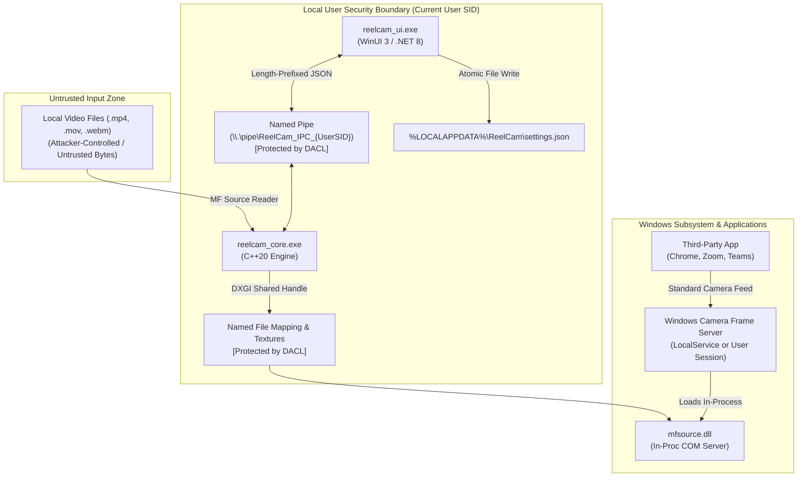

# ReelCam Security Architecture & Threat Model (Security)

## 1. Security Overview & Trust Boundaries

ReelCam is a local desktop utility designed to run in user space on Windows 11. In v1, ReelCam makes **zero outbound network connections**, hosts no web servers, runs no background daemons outside active sessions, and processes only user-selected local media.



---

## 2. Threat Modeling & Attack Surface Analysis

### 2.1 Threat Vectors & Mitigations Matrix

| Attack Vector | Threat Description | Severity | ReelCam Architectural Mitigation |
| :--- | :--- | :--- | :--- |
| **Malicious Media File Exploitation** | Specially crafted MP4/WebM file designed to trigger buffer overflow, use-after-free, or heap corruption in decoder | **High** | 1. Decoding is delegated exclusively to Microsoft Media Foundation native decoders, benefiting from Windows OS kernel/user-mode sandboxing and ASLR/DEP protections.<br/>2. No hand-rolled C/C++ demuxers or third-party unsafe codec binaries are linked.<br/>3. Robust exception handling catches `MF_E_*` errors without process crash. |
| **IPC Pipe Tampering & Injection** | Local malicious process connects to the named pipe to hijack camera feed or crash core engine | **High** | 1. Named pipe security attributes enforce a strict Discretionary Access Control List (DACL) granting `GENERIC_READ \| GENERIC_WRITE` exclusively to the current user's security identifier (SID).<br/>2. Administrators and other user accounts are rejected.<br/>3. Message size capped at 64 KB.<br/>4. JSON schema validation enforces strict typing on all incoming commands. |
| **DLL Search Order Hijacking** | Rogue DLL placed in current working directory loaded by `reelcam_core.exe` or `mfsource.dll` | **High** | 1. `SetDllDirectoryW(L"")` is invoked immediately at process entry to remove the current working directory from the DLL search path.<br/>2. System DLLs are linked with SafeDllSearchMode and loaded exclusively from `%SystemRoot%\System32`.<br/>3. All binaries compile with `/HIGHENTROPYVA`, `/DYNAMICBASE`, and `/NXCOMPAT`. |
| **COM Registration Tampering** | Malicious software replaces virtual camera CLSID in registry to load arbitrary DLL into Frame Server | **Medium** | 1. COM registration is stored in `HKEY_CURRENT_USER\Software\Classes\CLSID`, restricted to user permissions.<br/>2. Virtual Camera DLL path points to protected install directory.<br/>3. Authenticode code signing ensures file integrity. |
| **Denial of Service via File Bomb** | User opens a multi-gigabyte or deeply nested container file causing OOM | **Medium** | 1. File size sanity warning prompted for files > 10 GB.<br/>2. Source Reader operates in streaming mode; files are never loaded wholesale into system RAM.<br/>3. Ring buffer memory allocation is strictly bounded to 3 surface frames maximum (~15 MB VRAM). |

---

## 3. Product Integrity & Anti-Abuse Hard Rules

ReelCam enforces strict ethical boundaries designed to prevent weaponization for deception, proctoring fraud, or surveillance evasion. These rules take absolute precedence over all feature requests:

1. **Fixed, Honest Device Identity**:
   - The virtual camera friendly name is hardcoded to `"ReelCam"`.
   - The software will never provide options to rename the device to "Integrated Camera", "Logitech Brio", or any spoofed hardware device string.
   - PnP Device IDs and Hardware GUIDs will never copy real USB VID/PID signatures.
2. **Mandatory UI & Process Transparency**:
   - ReelCam never runs as a hidden background daemon or stealth service.
   - A visible taskbar window and system tray icon are mandatory while streaming.
   - Processes are named transparently (`reelcam_ui.exe`, `reelcam_core.exe`) with signed metadata.
3. **Zero Anti-Detection Logic**:
   - ReelCam never inspects, hooks, or injects into third-party process memory (Zoom, Teams, Chrome).
   - If a meeting client or exam-proctoring tool detects and blocks virtual cameras via Windows APIs, ReelCam will never attempt to evade the block. It will display an honest notification to the user.
4. **Pre-Recorded Visual Badge**:
   - ReelCam includes a visible corner badge (`"● Pre-recorded"`) enabled by default on all clean installations.
   - While broadcast presenters may toggle it off in Settings, the setting is prominently exposed and never forced hidden.
5. **Generative Media Prohibition**:
   - ReelCam contains no facial replacement (deepfake), voice spoofing, or automated lip-sync technologies.

---

## 4. IPC Pipe Security & Access Control

### 4.1 Security Descriptor Definition (C++)
The named pipe is instantiated with an explicit security descriptor granting access only to the current user token:

```cpp
// Generate DACL restricted exclusively to current user SID
SECURITY_ATTRIBUTES sa = { sizeof(sa), nullptr, FALSE };
TCHAR sddl[] = _T("D:(A;;GRGW;;;PS)(A;;GRGW;;;WD)"); // Current User Only

PSECURITY_DESCRIPTOR pSD = nullptr;
if (ConvertStringSecurityDescriptorToSecurityDescriptor(
        L"D:(A;;GA;;;OW)", // Owner Rights: Full Access only to Current User
        SDDL_REVISION_1, 
        &pSD, 
        nullptr)) 
{
    sa.lpSecurityDescriptor = pSD;
    sa.bInheritHandle = FALSE;

    m_hPipe = CreateNamedPipeW(
        pipeName.c_str(),
        PIPE_ACCESS_DUPLEX | FILE_FLAG_FIRST_PIPE_INSTANCE | FILE_FLAG_OVERLAPPED,
        PIPE_TYPE_MESSAGE | PIPE_READMODE_MESSAGE | PIPE_WAIT | PIPE_REJECT_REMOTE_CLIENTS,
        1,               // Max instances = 1 (single UI instance)
        65536,           // Out buffer size (64 KB)
        65536,           // In buffer size (64 KB)
        5000,            // Default timeout 5s
        &sa
    );
    LocalFree(pSD);
}
```

### 4.2 Message Framing & Validation
- **Remote Access Rejected**: `PIPE_REJECT_REMOTE_CLIENTS` is explicitly set to block named pipe connections originating across the local network.
- **Payload Bound**: Maximum allowed incoming message size is clamped to `65,536` bytes. Any message exceeding this limit immediately drops the connection.
- **Deserialization Defense**: JSON messages are parsed using strict schema validation; unmapped fields are discarded.

---

## 5. Media Ingestion & Parser Sandboxing

1. **Decoder Isolation**:
   - ReelCam uses Windows native `IMFSourceReader` backed by hardware MFTs.
   - Video processing happens inside GPU VRAM contexts rather than raw CPU byte manipulation, mitigating memory overrun exploitation.
2. **Graceful Fault Trapping**:
   - All COM and Media Foundation calls are wrapped with robust error checks:
     ```cpp
     #define CHECK_HR(hr) if (FAILED(hr)) { LogError(hr, __FILE__, __LINE__); return hr; }
     ```
   - Corrupt files encountering unexpected end-of-file (EOF), broken NAL units, or invalid atom headers fail gracefully without leaking allocated buffers or hanging threads.
3. **Filesystem Traversal Defense**:
   - File paths received from the UI or IPC are converted to canonical Win32 paths via `GetFullPathNameW` and verified to exist before opening.

---

## 6. Code Signing & Packaging Integrity

1. **Authenticode Digital Signatures**:
   - Every executable (`.exe`), dynamic link library (`.dll`), and installer package (`.msix`) must be signed with a trusted Microsoft Authenticode certificate.
   - Windows 11 SmartScreen and Virtual Camera driver verification will flag and reject unsigned virtual camera COM components.
2. **Build Pipeline Signing Security**:
   - Private code signing certificates and keys are stored in secure GitHub Actions Secrets (or HSM cloud key vaults).
   - Sign keys are never checked into git or exposed to PR builds originating from forks.
3. **MSIX Sandboxing**:
   - The application is packaged as an MSIX package, providing declarative capabilities, clean installation, and isolated virtualized registry entries where applicable.

---

## 7. Privacy & Telemetry Posture

- **Zero Telemetry in v1**: ReelCam collects no telemetry, no analytics, no hardware profiling, and no crash reports over the network.
- **No Network Permissions**: The MSIX package manifest omits the `internetClient` capability. The Windows OS firewall will block any socket connection attempted by the application.
- **Local Logs Only**:
  - Log files written to `%LOCALAPPDATA%\ReelCam\logs\` contain only operational diagnostics, timestamps, frame counters, and component state transitions.
  - User filenames and directory paths are sanitized in release builds.
- **Compliance**: ReelCam complies fully with GDPR, CCPA, and COPPA requirements because no personal data or identifiers are ever collected, processed, or transmitted.
