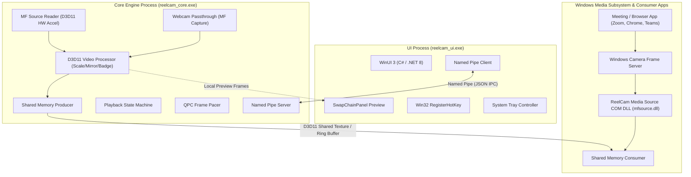
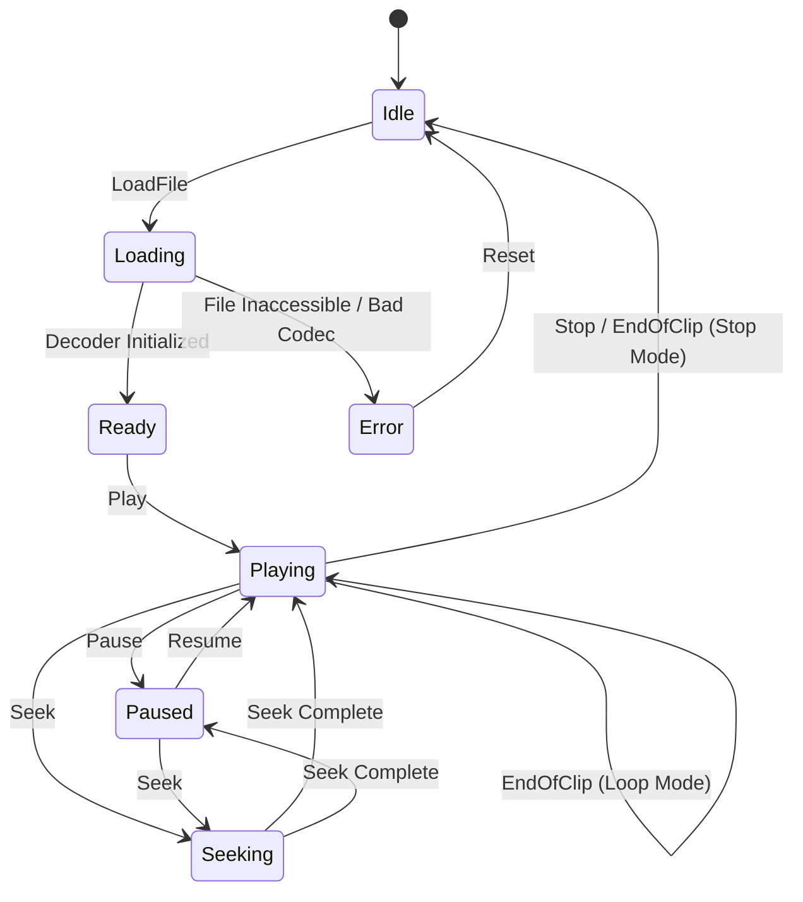

# ReelCam Technical Specification (Techspec)

## 1. Architectural Overview & System Topology

ReelCam is architected as a decoupled, multi-process desktop system designed for low latency, fault isolation, and maximum stability.

### 1.1 Process Model & Component Topology



### 1.2 Isolation & Crash Recovery Principle
A critical architectural requirement is that **consuming applications must never crash or freeze if ReelCam's UI or Core process terminates**.
- The Media Source COM DLL (`mfsource.dll`) is loaded directly into the Windows Camera Frame Server or consuming process.
- `mfsource.dll` contains **zero decoding logic** and zero file I/O. It functions strictly as a consumer of shared memory.
- If `reelcam_core.exe` crashes, terminates, or hangs, `mfsource.dll` detects the heartbeat loss via a shared monotonic counter, automatically transitions to generating fallback idle color bars or an embedded static slate, and continues delivering valid video frames to Zoom/Chrome at the negotiated frame rate.

---

## 2. Media Foundation Virtual Camera Architecture

### 2.1 Virtual Camera Registration (`MFCreateVirtualCamera`)
ReelCam targets Windows 11 Build 22000+ utilizing the modern user-mode Media Foundation Virtual Camera API. No kernel-mode drivers (`.sys`) are employed.

1. **API Invocation**:
   ```cpp
   HRESULT hr = MFCreateVirtualCamera(
       MFVirtualCameraType_SoftwareCameraSource,
       MFVirtualCameraLifetime_User,
       MFVirtualCameraAccess_CurrentUser,
       L"ReelCam",
       L"{E7B1A280-9A23-4560-BD92-358F58A009C1}", // ReelCam Media Source CLSID
       nullptr,
       &m_pVirtualCamera
   );
   ```
2. **Registration Parameters**:
   - `MFVirtualCameraType_SoftwareCameraSource`: Indicates a software-based IMFMediaSource provider.
   - `MFVirtualCameraLifetime_User`: The virtual device persists across reboots for the current user until explicitly unregistered.
   - `MFVirtualCameraAccess_CurrentUser`: Restricts device creation and access to the calling Windows user session without requiring elevated Administrator rights.
   - `FriendlyName`: Strictly set to `"ReelCam"`.

### 2.2 Custom Media Source COM Implementation
The COM DLL (`mfsource.dll`) implements the following core Media Foundation interfaces:
- `IMFMediaSource`: Top-level source controller managing presentation descriptor and streams.
- `IMFMediaStream`: Video stream sample generator delivering `IMFSample` instances.
- `IMFMediaEventGenerator`: Event pipeline for Media Foundation asynchronous state dispatch (`MEEndOfStream`, `MENewStream`, etc.).
- `IMFGetService`: Service provider interface exposing `MF_MEDIASOURCE_SERVICE`.
- `IMFQualityAdvise`: Quality manager to handle frame drops requested by consuming applications.

### 2.3 Media Type & Format Negotiation
The stream's `IMFMediaTypeHandler` exposes standardized media types:
1. **Primary Output Format**: `MFVideoFormat_NV12` (Direct3D 11 native video surface format, zero-copy into browser WebRTC pipelines).
2. **Compatibility Fallbacks**: `MFVideoFormat_YUY2` and `MFVideoFormat_RGB32`.
3. **Supported Profiles**:
   - 1920 x 1080 @ 30.00 fps (10,000,000 / 333,333 nano-seconds per frame)
   - 1920 x 1080 @ 60.00 fps (10,000,000 / 166,666 nano-seconds per frame)
   - 1280 x 720 @ 30.00 fps
   - 1280 x 720 @ 60.00 fps

---

## 3. Video Decoding Pipeline

### 3.1 Media Foundation Source Reader with D3D11 Acceleration
Video files are decoded using the asynchronous `IMFSourceReader` configured for hardware acceleration:

```cpp
ComPtr<IMFAttributes> pAttributes;
MFCreateAttributes(&pAttributes, 4);
pAttributes->SetUINT32(MF_SOURCE_READER_ENABLE_ADVANCED_VIDEO_PROCESSING, TRUE);
pAttributes->SetUINT32(MF_READWRITE_ENABLE_HARDWARE_TRANSFORMS, TRUE);
pAttributes->SetUINT32(MF_SOURCE_READER_D3D11_AWARE, TRUE);
pAttributes->SetUnknown(MF_SOURCE_READER_D3D_MANAGER, m_pDXGIManHandle.Get());

MFCreateSourceReaderFromURL(filePath.c_str(), pAttributes.Get(), &m_pSourceReader);
```

### 3.2 Supported Formats & Codecs (v1)
- **Container Formats**: `.mp4`, `.mov`, `.mkv`, `.webm`.
- **Video Codecs**:
  - **H.264 (AVC)**: Baseline, Main, High Profiles via Microsoft D3D11 Video Decoder MFT.
  - **VP9**: Supported via Windows Web Media Extensions MFT.
  - **AV1**: Supported via Windows AV1 Video Extension MFT.
- **H.265 (HEVC) Policy**: Explicitly omitted from v1 to prevent proprietary licensing entanglements and absent OS decoder dependencies on un-licensed Windows SKUs.

### 3.3 Hardware-to-Software Fallback Mechanism
If the user's GPU runs out of video memory (VRAM) or encounters a driver crash (`DXGI_ERROR_DEVICE_REMOVED`), the decoding engine resets its DXGI manager, releases the D3D11 device, and reinitializes `IMFSourceReader` without `MF_SOURCE_READER_D3D11_AWARE` to continue in software YUV conversion mode.

---

## 4. Frame Pipeline, Video Processing & Pacing Engine

### 4.1 Processing Pipeline (Direct3D 11 Video Processor)
Every raw decoded frame traverses a high-performance GPU pixel pipeline before entry into shared memory:
1. **Source Surface**: Decoded NV12 texture from Source Reader.
2. **Video Processing**:
   - Aspect ratio correction & scaling (`Fit/Letterbox`, `Fill/Crop`, or `Stretch`).
   - Mirror transformation: Horizontal flip matrix applied in D3D11 viewport if enabled.
   - Pre-recorded badge watermark: Hardware blending of an RGBA32 texture overlay into the designated corner.
3. **Target Surface**: Rendered into an NV12 shared texture handle.

### 4.2 Shared Memory Architecture
To transfer frames with sub-millisecond overhead between `reelcam_core.exe` and `mfsource.dll`, ReelCam implements a **Shared DXGI Texture Handle with Circular Ring Synchronization**:
- A Win32 Named File Mapping (`Local\ReelCam_FrameBuffer_{SessionId}`) maintains a lockless header:
  ```cpp
  struct SharedFrameHeader {
      uint32_t magic;           // 0x5245454C ('REEL')
      uint32_t version;         // Protocol version (1)
      uint64_t sequenceNumber;  // Monotonically increasing frame index
      uint64_t timestampQPC;    // QueryPerformanceCounter timestamp
      int64_t  ptsNanoSeconds;  // Presentation timestamp
      uint32_t width;           // e.g. 1920
      uint32_t height;          // e.g. 1080
      uint32_t format;          // DXGI_FORMAT_NV12
      uint32_t stride;          // Pitch in bytes
      HANDLE   sharedDxgiHandle;// NT Handle for D3D11 shared texture
      uint32_t isCoreActive;    // Heartbeat counter incremented every frame
  };
  ```
- Two named synchronization events:
  - `Local\ReelCam_FrameAvailable_{SessionId}`: Set by Core when a new frame is committed.
  - `Local\ReelCam_FrameConsumed_{SessionId}`: Set by MF Source when read.

### 4.3 High-Precision Frame Pacing Algorithm
ReelCam strictly prohibits `Sleep()` calls for video frame timing. Frame scheduling uses Windows High-Resolution Waitable Timers (`CREATE_WAITABLE_TIMER_HIGH_RESOLUTION`):

```cpp
LARGE_INTEGER qpcFreq, qpcStart, qpcNow;
QueryPerformanceFrequency(&qpcFreq);
QueryPerformanceCounter(&qpcStart);

// Pacing Loop:
int64_t targetQPC = qpcStart.QuadPart + (ptsFrame * qpcFreq.QuadPart / 10000000ULL);
QueryPerformanceCounter(&qpcNow);

if (targetQPC > qpcNow.QuadPart) {
    int64_t diff100ns = -((targetQPC - qpcNow.QuadPart) * 10000000ULL / qpcFreq.QuadPart);
    LARGE_INTEGER dueTime;
    dueTime.QuadPart = diff100ns;
    SetWaitableTimerEx(m_hTimer, &dueTime, 0, nullptr, nullptr, nullptr, 0);
    WaitForSingleObject(m_hTimer, INFINITE);
}
```

---

## 5. IPC Protocol & Subsystem Communication

Communication between `reelcam_ui.exe` (C#) and `reelcam_core.exe` (C++) occurs over a local Windows Named Pipe.

- **Pipe Endpoint**: `\\.\pipe\ReelCam_IPC_{CurrentUserName}`
- **Security Descriptor**: DACL restricted exclusively to the current user's SID (elevated or cross-account access rejected).
- **Transport Format**: UTF-8 encoded JSON framing with 4-byte big-endian payload length header:
  `[4 Bytes Length][JSON Payload]`

### 5.1 Protocol Message Schema
All requests and responses implement the envelope pattern:
```json
{
  "$schema": "https://reelcam.io/schemas/ipc-v1.json",
  "version": 1,
  "messageId": "9b1deb4d-3b7d-4bad-9bdd-2b0d7b3dcb6d",
  "type": "Command",
  "name": "LoadFile",
  "payload": {
    "filePath": "C:\\Users\\DELL\\Videos\\demo_presentation.mp4",
    "autoPlay": false
  }
}
```

### 5.2 Command Catalog
| Command | Direction | Parameters | Description |
| :--- | :--- | :--- | :--- |
| `LoadFile` | UI → Core | `filePath`, `autoPlay` | Open file, initialize decoder, set status to Ready |
| `Play` | UI → Core | None | Begin paced playback from current PTS |
| `Pause` | UI → Core | None | Halt pacing, hold current frame on virtual device |
| `Stop` | UI → Core | None | Reset PTS to 0, transition virtual camera to Idle Source |
| `Seek` | UI → Core | `targetPtsMs` | Scrub video to specific millisecond timestamp |
| `SetOutputSettings` | UI → Core | `resolution`, `fps`, `scalingMode`, `mirror` | Dynamically update processing pipeline parameters |
| `SetBadge` | UI → Core | `enabled`, `position`, `opacity` | Configure pre-recorded badge overlay |
| `SetIdleSource` | UI → Core | `type`, `customImagePath`, `webcamId` | Configure fallback frame source |
| `StateChangedNotification` | Core → UI | `state`, `currentPtsMs`, `durationMs`, `droppedFrames` | Broadcast telemetry (10 Hz rate) |

### 5.3 Core Engine State Machine


---

## 6. UI Architecture (C# / WinUI 3)

### 6.1 Technology Stack & Structure
- **Framework**: .NET 8, Windows App SDK 1.5+ (WinUI 3).
- **Design Language**: Windows 11 Fluent Design (Mica backdrop, Segoe UI Variable typography, standard control styling).
- **Architecture**: Model-View-ViewModel (MVVM) utilizing CommunityToolkit.Mvvm.

### 6.2 View Layout Hierarchy
1. **Main Window (`MainWindow.xaml`)**:
   - **Header Bar**: Branded title, device status pill (`Live`, `Idle`, `Paused`), Settings button.
   - **Video Preview Canvas**: Custom `SwapChainPanel` receiving low-latency DXGI swapchain output.
   - **Playback Bar**:
     - Large Play/Pause/Stop primary actions.
     - Seek Slider bound to `CurrentPtsMs` and `DurationMs`.
     - Timestamp indicator (`00:04:12 / 00:32:00`).
     - Loop toggle button.
     - Webcam passthrough toggle switch.
   - **Quick Settings Bar**: Resolution selector, scaling mode selector, mirror toggle.
2. **Settings Dialog (`SettingsDialog.xaml`)**:
   - Virtual camera status & device installation verification.
   - Pre-recorded badge configuration (Position, Opacity, Enabled toggle).
   - Global hotkey key combination editors.
   - Idle frame source selector (Default slate, Custom image, Physical camera).
   - Recent files manager.

---

## 7. Performance Budgets & Hardware Targets

| Subsystem | Target Budget | Enforcement Mechanism |
| :--- | :--- | :--- |
| **CPU Utilization** | < 10% average on i5-1135G7 | Hardware D3D11 decoding + DXGI zero-copy pipeline |
| **System Memory (RAM)** | < 150 MB (UI) / < 120 MB (Core) | Ring buffer memory cap (max 3 decoded surfaces) |
| **GPU Dedicated VRAM** | < 180 MB | Stride-aligned textures (3 x 1080p NV12 buffers ≈ 15 MB + D3D runtime) |
| **Frame Delivery Jitter** | < ±2.0 ms | Waitable timer with QPC synchronization |
| **Preview Latency** | < 16.6 ms (1 frame) | Direct swapchain presentation |
| **IPC Roundtrip Time** | < 5 ms | Overlapped asynchronous named pipe I/O |

---

## 8. Deployment & Platform Matrix

### 8.1 OS Version Support Matrix
- **Supported**:
  - Windows 11 21H2 (Build 22000)
  - Windows 11 22H2 (Build 22621)
  - Windows 11 23H2 (Build 22631)
  - Windows 11 24H2 (Build 26100)
- **Unsupported**:
  - Windows 10 (Build 19045 and earlier): `MFCreateVirtualCamera` does not exist in user mode on Windows 10. DirectShow fallback is deferred to v2.

### 8.2 Installation & Code Signing
- **Installer Format**: Windows App Package (`.msix`).
- **COM Registration**: Per-user registration via MSIX Application Extensions (`windows.comServer`).
- **Signing**: All executable binaries (`reelcam_ui.exe`, `reelcam_core.exe`, `mfsource.dll`) and the `.msix` container must be signed with a valid Microsoft Authenticode certificate. Unsigned binaries will fail Windows SmartScreen and Virtual Camera driver verification.
